<picture><source media="(prefers-color-scheme: dark)" srcset="assets/header-dark.svg"/><source media="(prefers-color-scheme: light)" srcset="assets/header-light.svg"/></picture>

 

  

<picture><source media="(prefers-color-scheme: dark)" srcset="assets/skills-dark.svg"/><source media="(prefers-color-scheme: light)" srcset="assets/skills-light.svg"/></picture>

---

## 👋 Hey, I'm Piks

I'm a **3rd-year BCA student** at **Asansol Engineering College** (Year 1 CGPA **9.48**, Year 2 **9.09**) working on computer vision and NLP, from training models to deploying them as web apps. 🌿

- 🧪 I care about **honest evaluation**: held-out test sets, calibration, confusion matrices. A pretty accuracy number means nothing if the model fails where it matters
- 🌪️ **SIH 2026 (SIH260070):** Evaluation Lead on a tropical cyclone intensity classifier
- 🌱 **Hacktoberfest 2026 Completionist**, built Stuck Doctor at the offline meet and wrote it up on DEV
- 🛠️ In progress: a **Student Dropout prediction web app** and a **healthcare AI/ML project**
- 🎨 Off-screen: nature & the outdoors 🌳, sketching, creative arts, psychology, sports, and way too much fun tech
- 💼 Open to internship opportunities (hybrid / remote)

---

## 🚀 Featured Projects

<a href="https://github.com/KK-Dev0/Predictive-Decision-Support-AI"><picture><source media="(prefers-color-scheme: dark)" srcset="assets/creditsense-dark.svg"/><source media="(prefers-color-scheme: light)" srcset="assets/creditsense-light.svg"/></picture></a>
<a href="https://github.com/KK-Dev0/Document-Classification-AI"><picture><source media="(prefers-color-scheme: dark)" srcset="assets/docclassify-dark.svg"/><source media="(prefers-color-scheme: light)" srcset="assets/docclassify-light.svg"/></picture></a>
 
<a href="https://github.com/KK-Dev0/Mosquito-Breeding-Detector"><picture><source media="(prefers-color-scheme: dark)" srcset="assets/backyard-dark.svg"/><source media="(prefers-color-scheme: light)" srcset="assets/backyard-light.svg"/></picture></a>
<a href="https://github.com/KK-Dev0/PRISM-TC"><picture><source media="(prefers-color-scheme: dark)" srcset="assets/vayuvega-dark.svg"/><source media="(prefers-color-scheme: light)" srcset="assets/vayuvega-light.svg"/></picture></a>
 
<a href="https://github.com/KK-Dev0/Stuck_Doctor"><picture><source media="(prefers-color-scheme: dark)" srcset="assets/stuckdoctor-dark.svg"/><source media="(prefers-color-scheme: light)" srcset="assets/stuckdoctor-light.svg"/></picture></a>
<a href="https://github.com/KK-Dev0/TaskFlow"><picture><source media="(prefers-color-scheme: dark)" srcset="assets/taskflow-dark.svg"/><source media="(prefers-color-scheme: light)" srcset="assets/taskflow-light.svg"/></picture></a>
 

Click any card to open the repo. All six have live demos on my <a href="https://kk-dev0.github.io">portfolio</a>.

### 🔨 Cooking right now
- 🎓 **Student Dropout Prediction Web App**
- 🏥 **Healthcare AI/ML project** *(details soon)*

---

## 🏅 Beyond the Code

| | |
|---|---|
| 🌐 **GDGC AEC** | Regular at Google Developer Group on Campus events, including the 3-day **Web Dev Bootcamp** where we built a live game from scratch with HTML, CSS & JavaScript |
| 🔧 **AEC Hardware Club** | **IHMMC-2026** (Innovative Hardware Model Making Competition): built a **Mining Gas Alarm System** model |
| 🏆 **Smart India Hackathon** | SIH 2026, Evaluation Lead (tropical cyclone forecasting) |
| 💻 **Hackoverflow 10.0** | Aarohan, NIT Durgapur, as Team CokeZer01 |
| 🤝 **NSS @ AEC** | Community service initiatives |
| 🌱 **Hacktoberfest 2026** | Challenge Completion + Completionist + Fest Attendee badges on DEV |
| ✍️ **Writing** | Dev write-ups on [DEV Community](https://dev.to/piks_dev) |

---

## 📊 GitHub Stats

---

## 🐍 Contribution Snake

<picture>
  <source media="(prefers-color-scheme: dark)" srcset="https://raw.githubusercontent.com/KK-Dev0/KK-Dev0/output/github-snake-dark.svg" />
  <source media="(prefers-color-scheme: light)" srcset="https://raw.githubusercontent.com/KK-Dev0/KK-Dev0/output/github-snake.svg" />
  
</picture>

---

## 🤝 Let's Connect

I'm always up for **ML projects, hackathon teams, and open-source collabs**.

  

<i>"little steps, big progress ✦"</i>

